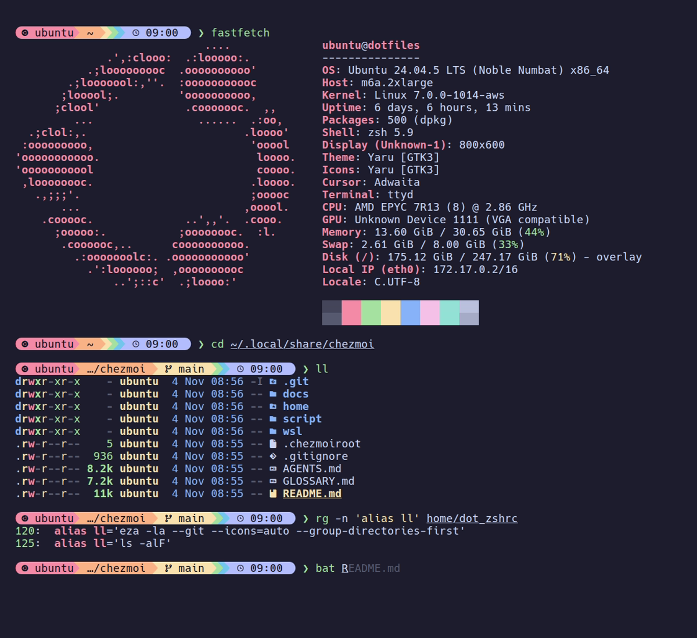
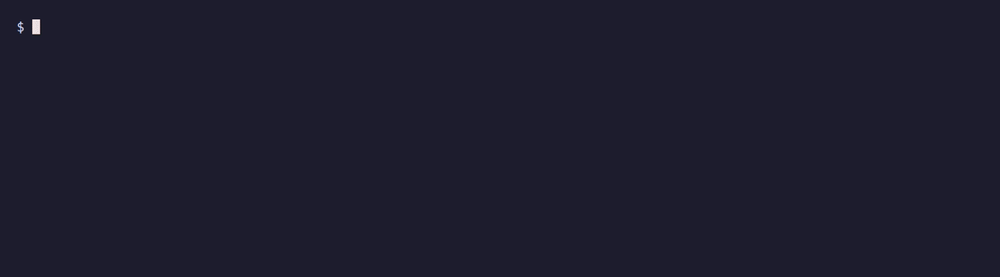

# dotfiles

個人公開設定，用 [chezmoi](https://www.chezmoi.io/) 管理：一行指令裝好 zsh、常用 CLI 工具與 coding agent
（Claude Code、Codex、opencode）。以 **Linux + 純 zsh** 為主，Ubuntu 等 Debian 系最完整；也用在 macOS 與
Android 平板（Termux）。實體機、雲端主機、WSL2 都一樣裝，有沒有 root 都行，機器種類自動判斷。
Windows 也用同一個 repo（WSL 的外層，或沒有 WSL 的開發機）：同一套用途與選單，CLI 用 mise、app 用 winget 裝，見[Windows 主機](docs/how-to/windows.md)。



## 安裝

Linux 在家目錄跑：

```bash
sh -c "$(curl -fsLS get.chezmoi.io/lb)" -- init --apply henry5720
```



會問用途（完整／精簡／自訂）和要勾哪些選裝工具；勾到要憑證的工具才問憑證。clone 走 HTTPS，不用 key。
macOS、Windows 主機、免回答的裝法、事前準備、各種機器會裝什麼，見[新機器設定](docs/new-machine-setup.md)；
Termux 見[平板：原生 Termux 與 proot Ubuntu](docs/new-machine-setup.md#平板原生-termux-與-proot-ubuntu)。

## 裝完之後

| 想做什麼 | 看哪份 |
|---|---|
| 知道裝了什麼、各自怎麼用 | [工具一覽](docs/tools.md) |
| 從個人電腦連進這台、開 herdr 與 coding agent、傳檔案、讓 agent 用瀏覽器 | [操作已配置主機](docs/configured-host.md)（開頭有常用指令速查） |
| 加減選裝工具、改 API key 與密碼、拉最新版 | [改設定與更新](docs/after-install.md) |
| Windows 主機：裝了什麼、PowerShell 的 `z`、補全、灰字建議 | [Windows 主機：裝了什麼、怎麼用](docs/how-to/windows.md#裝了什麼怎麼用) |

最常用的兩個：

```bash
tools                                  # 改用途、加減選裝工具（每台都有，Windows 是 PowerShell 版）；取消勾選時 mise 裝的會移除，其他不解除安裝
chezmoi edit-config && chezmoi apply   # 改 API key、密碼、Git 身分
```

## 文件索引

分類見 [`AGENTS.md`](AGENTS.md)「文件放哪」。

**機器與環境**

| 文件 | 什麼時候看 |
|---|---|
| [用途與憑證](docs/how-to/machine-use.md) | 完整／精簡／自訂各勾哪些、勾了哪個工具會問哪個憑證 |
| [沒有 root 的機器](docs/how-to/no-root-machine.md) | 不能 `sudo` 的帳號：會自動處理什麼、略過彙整、tailscale 登入、連已配置主機的 key |
| [終端機字型](docs/how-to/fonts.md) | 圖示變方框、裝 Nerd Font、中文字形、換別的字型 |
| [Windows 主機](docs/how-to/windows.md) | Windows 上的 chezmoi 部署什麼、裝了哪些工具、PowerShell 怎麼用、Documents 移出 OneDrive |
| [Windows 上的 skill](docs/how-to/windows-skills.md) | agent-config 的 skill 哪些在 Windows 不能用、卡在哪 |
| [WSL 網路](docs/how-to/windows.md#wsl-網路mirrored-與-nat-portproxy) | mirrored 模式、NAT 時的 port 轉發 |
| [Hyper-V](docs/how-to/hyper-v.md) | 在 Windows 上開一台 Windows VM：建 VM、不登入微軟帳號、NAT 與橋接、主機傳檔進 VM |

**coding agent**

| 文件 | 什麼時候看 |
|---|---|
| [架構〈AI agent 環境：誰管什麼〉](docs/architecture.md#ai-agent-環境誰管什麼) | 改規則、skill、MCP、plugin 前，先看該去哪改 |

mise、earlyoom、herdr、opencode、codegraph、playwright-cli、WakaTime、ai-profile 這些單一工具的文件，從[工具一覽](docs/tools.md)連過去。

**連線與分享**

| 文件 | 什麼時候看 |
|---|---|
| [開給別人連](docs/how-to/remote-access/) | 把一個服務開給人或 agent 連：概念圖、tailnet 內走 ssh／`tailscale serve`、tailnet 外用 Funnel 或 quick tunnel；服務卡：[瀏覽器](docs/how-to/remote-access/browser.md)（agent 的 headless、讓 agent 控你的 Chrome）、[share-shell](docs/how-to/remote-access/share-shell.md)、[code-server](docs/how-to/remote-access/code-server.md)、[voice-out](docs/how-to/remote-access/voice-out.md)（agent 的回覆唸到個人電腦）、[開 sshd](docs/how-to/remote-access/sshd.md)（各平台讓別台 ssh 進來） |

改這個 repo：結構看 [`docs/architecture.md`](docs/architecture.md)，規則看 [`AGENTS.md`](AGENTS.md)。
