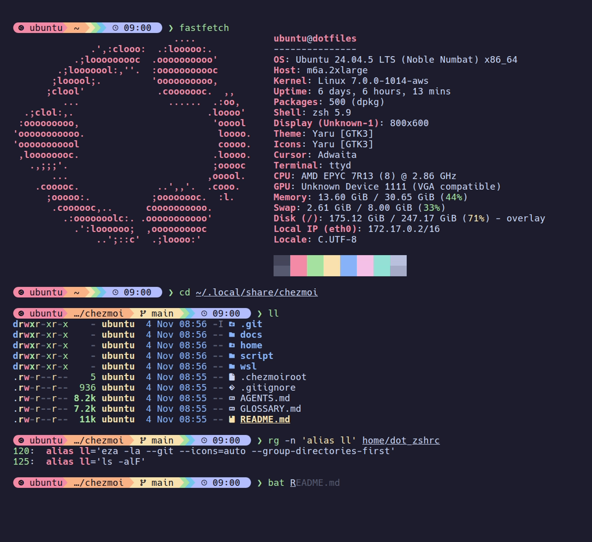
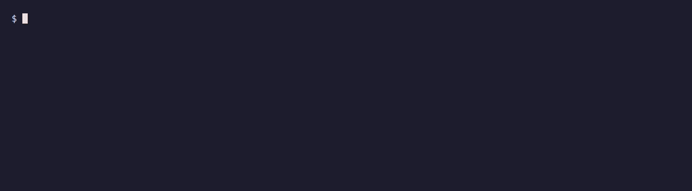

# dotfiles

個人公開設定，用 [chezmoi](https://www.chezmoi.io/) 管理：一行指令裝好 zsh、常用 CLI 工具與 coding agent
（Claude Code、Codex、opencode）。以 **Linux + 純 zsh** 為主，Ubuntu 等 Debian 系最完整；也用在 macOS 與
Android 平板（Termux）。實體機、雲端主機、WSL2 都一樣裝，有沒有 root 都行，機器種類自動判斷。



## 安裝

Linux 在家目錄跑：

```bash
sh -c "$(curl -fsLS get.chezmoi.io/lb)" -- init --apply henry5720
```



會問用途（完整／精簡／自訂）和要勾哪些選裝工具；勾到要憑證的工具才問憑證。clone 走 HTTPS，不用 key。
macOS、Termux、Windows 主機、免回答的裝法、事前準備、各種機器會裝什麼，見[新機器設定](docs/new-machine-setup.md)。

## 裝完之後

| 想做什麼 | 看哪份 |
|---|---|
| 知道裝了什麼、各自怎麼用 | [工具一覽](docs/tools.md) |
| 從個人電腦連進這台、開 herdr 與 coding agent、傳檔案 | [操作已配置主機](docs/configured-host.md) |
| 加減選裝工具、改 API key 與密碼、拉最新版 | [改設定與更新](docs/after-install.md) |

最常用的兩個：

```bash
tools                                  # 改用途、加減選裝工具（Linux、macOS；Termux 沒有）；取消勾選不會解除安裝
chezmoi edit-config && chezmoi apply   # 改 API key、密碼、Git 身分
```

## 文件索引

分類見 [`AGENTS.md`](AGENTS.md)「文件放哪」。

**機器與環境**

| 文件 | 什麼時候看 |
|---|---|
| [用途與憑證](docs/machine-use.md) | 完整／精簡／自訂各勾哪些、勾了哪個工具會問哪個憑證 |
| [沒有 root 的機器](docs/no-root-machine.md) | 不能 `sudo` 的帳號：會自動處理什麼、略過彙整、tailscale 登入、連 company-ec2 的 key |
| [mise](docs/mise.md) | Linux 上 eza、fzf 這類工具誰裝的、怎麼更新、移除、限流 |
| [終端機字型](docs/fonts.md) | 圖示變方框、裝 Nerd Font、中文字形、換別的字型 |
| [Windows 主機](docs/windows.md) | Windows 上的 chezmoi 部署什麼、改完要在實機確認哪幾項 |
| [WSL 網路](docs/windows.md#wsl-網路mirrored-與-nat-portproxy) | mirrored 模式、NAT 時的 port 轉發 |
| [Herdr notifications](docs/herdr-notifications.md) | WSL2 通知音、PulseAudio 排錯 |

**coding agent**

| 文件 | 什麼時候看 |
|---|---|
| [AI agent 環境：誰管什麼](docs/ai-agent-setup.md) | 改規則、skill、MCP、plugin 前，先看該去哪改 |
| [AI profile routing](docs/ai-profile-routing.md) | 切換公司／個人的 CLI、登入前置 |
| [opencode 設定](docs/opencode.md) | 改 provider、agent、plugin，驗證 `opencode.json` |
| [codegraph](docs/codegraph.md) | 建索引、worktree 與 git hook、husky 搶走 `core.hooksPath` |
| [playwright-cli](docs/playwright-cli.md) | 讓 agent 點網頁、截圖，瀏覽器從哪來 |
| [remote-chrome](https://github.com/henry5720/agent-config/blob/main/docs/skills/remote-chrome.md)（在 agent-config） | 設定瀏覽器 MCP、轉發到 EC2、排錯 |
| [WakaTime](docs/wakatime.md) | 勾了 `wakatime` 會裝哪些 plugin、沒記到時看哪 |

**連線與分享**

| 文件 | 什麼時候看 |
|---|---|
| [code-server remote](docs/code-server-remote.md) | 從其他裝置連 code-server |
| [開給訪客看](docs/share-with-guest.md) | 把 shell 或 dev server 臨時開給沒有 tailscale 的人 |

**背景與決策**

| 文件 | 什麼時候看 |
|---|---|
| [AI agent 環境：為什麼這樣分](docs/ai-agent-principles.md) | 規則寫什麼、放哪；要不要裝一個新工具 |
| [瀏覽器偵錯 MCP 對照](docs/browser-mcp-comparison.md) | 選 Playwright 還是 chrome-devtools-mcp |
| [`docs/adr/`](docs/adr/) | 想知道某個不直覺的做法為什麼這樣定 |

## 改這個 repo

檔名前綴、秘密、驗證方式（含容器 e2e）、issue 流程看 [`AGENTS.md`](AGENTS.md)。
`docs/superpowers/`、`docs/research/` 是當時的 spec、plan 與研究紀錄，不是現行文件。

### repo 結構

```text
.chezmoiroot                    內容是 home：chezmoi 只看 home/，其餘它看不到
home/                           → 部署到 ~（chezmoi apply）
├── .chezmoi.toml.tmpl          → ~/.config/chezmoi/chezmoi.toml：憑證、Git 身分、選裝工具
├── .chezmoidata/               不部署：基底套件與走 apt 的選裝工具清單
├── .chezmoitemplates/          不部署：樣板共用片段（選單的選項與說明、判斷 WSL／Debian、腳本共用函式…）
├── .chezmoiexternal.toml.tmpl  → ~/.config/zsh/*、Termux 字型（apply 時下載）
├── .chezmoiscripts/            不部署，apply 時執行：裝套件、選裝工具、換預設 shell
├── dot_zshrc                   → ~/.zshrc
├── modify_dot_bashrc.tmpl      → ~/.bashrc 最後加段落：starship、沒有 root 時切 zsh
├── dot_gitconfig.tmpl          → ~/.gitconfig：Git 身分、HTTPS clone／SSH push
├── dot_wslconfig               → Windows 主機的 %USERPROFILE%\.wslconfig（只部署到 Windows）
├── dot_config/                 → ~/.config/：nvim、git hooks、zsh、starship、opencode…
├── dot_claude/                 → ~/.claude/：設定（選單勾了 claude 才部署）
├── dot_codex/                  → ~/.codex/：同上（勾了 codex 才部署）
├── dot_local/bin/              → ~/.local/bin/：自己的指令（tools、ai-profile、remote-chrome…）
├── dot_local/share/fonts/      → ~/.local/share/fonts/：Termux 字型的 symlink
└── private_dot_ssh/            → ~/.ssh/（700）：SSH config
script/                         不部署，自己手動跑
├── ubuntu/                     會改系統的：Docker、swap
├── termux/                     平板桌面、proot Ubuntu 的使用者
├── tests/                      容器 e2e 與單元測試
└── demo/                       重錄 README 與工具一覽的截圖、安裝 GIF
docs/                           說明（見上面的文件索引）
```

- 檔名前綴（`dot_`、`private_`、`symlink_`、`.tmpl`…）決定部署結果，規則見
  [target types](https://www.chezmoi.io/reference/target-types/)；逐檔清單跑 `chezmoi managed`。
- skills、MCP 和全域規則（`CLAUDE.md`／`AGENTS.md`、commit 指引）的內容在 agent-config，這裡只放
  skillshare 的 `config.yaml`，其中 targets、extras 段照選單勾的 client 產生，決定 skills 與規則連到哪（[ADR 0003](docs/adr/0003-agent-instructions-linked-by-skillshare-extras.md)）；見 agent-config 的
  [skill](https://github.com/henry5720/agent-config/blob/main/docs/skills/README.md)、[MCP](https://github.com/henry5720/agent-config/blob/main/docs/mcp.md)。
- Windows 主機也用這個 repo，只部署 `home/.chezmoiignore` Windows 段白名單上的檔案，見[Windows 主機](docs/windows.md)；
  為什麼這樣分見 [Wayfinder: Windows 側交給 chezmoi（PowerShell、WSL、Windows Terminal）](https://github.com/henry5720/dotfiles/issues/167)。
- chezmoi 本身的日常用法照官方 [daily operations](https://www.chezmoi.io/user-guide/daily-operations/)。

### fork 前要改什麼

- [ ] 安裝指令與 ssh config（`home/private_dot_ssh/private_config.tmpl`）寫死 `henry5720` 帳號和 `~/.ssh/henry5720` 這把 key
- [ ] agent-config 的 remote（`home/.chezmoiscripts/run_onchange_after_install-agent-config.sh.tmpl`）
- [ ] AI provider、model 與 agent 規則（`home/dot_codex/`、`home/dot_config/opencode/`、agent-config）
- [ ] ssh config 裡的 Tailscale 主機與平板
- [ ] 已有設定的機器先備份；不要未檢查就部署別人的個人 dotfiles
- [ ] 憑證不進 git，`chezmoi init` 時才問、存在 `~/.config/chezmoi/chezmoi.toml`；不信任或共用的機器不要填真實憑證
