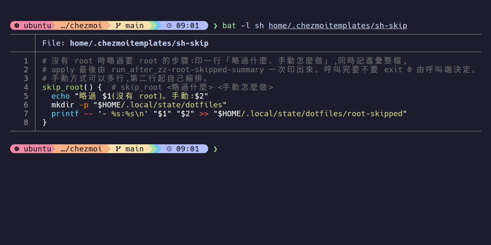
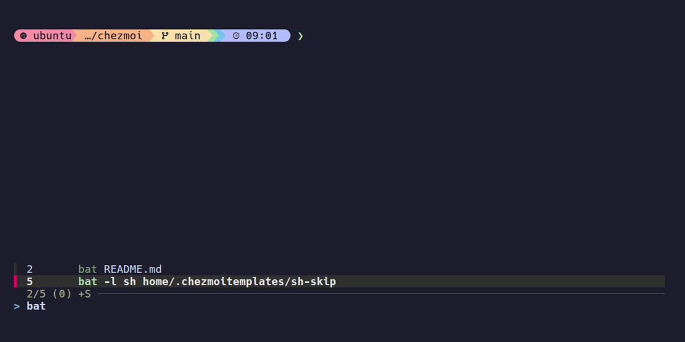

# 工具一覽

已配置主機上有哪些工具、各自最常用的一兩個指令。其餘用法照官網；這個 repo 有細節文件的，連在最後一欄。
怎麼連上已配置主機、怎麼開 agent，見[操作已配置主機](configured-host.md)。

哪些工具會裝，看那台的用途與勾選（[用途與憑證](install/machine-use.md)）；要加減用 `tools`。

```
shell 日常      zsh  starship  eza  fzf  bat  ripgrep  vim  fastfetch  btop
入口與連線      tailscale  cloudflared  code-server  ttyd  gh
coding agent    herdr  claude  codex  opencode  agent-config
agent 輔助      codegraph  headless-chrome  playwright-cli  node
其他            ffmpeg  snapserver  snapclient  wakatime  earlyoom
自寫指令        tools  ai-profile  share-shell  personal-chrome-attach
                codegraph-setup-repo  voice-out  voice-out-speak
```

## shell 日常

| 工具 | 做什麼 | 常用 | 官網 |
|---|---|---|---|
| zsh | 預設 shell；打字時灰字建議、指令上色、跳常去的目錄 | `→` 接受灰字建議；`z <目錄名片段>` 跳過去 | [zsh](https://www.zsh.org/) |
| starship | 提示列：目錄、git 分支與狀態 | 不用打指令，自動顯示 | [starship](https://starship.rs/) |
| eza | 彩色、帶圖示的 ls | `ll` 詳細列表、`lt` 兩層樹狀 | [eza](https://eza.rocks/) |
| fzf | 模糊搜尋 | `Ctrl-R` 找打過的指令、`Ctrl-T` 找檔案 | [fzf](https://github.com/junegunn/fzf) |
| bat | 有語法上色的 cat | `bat <檔案>` | [bat](https://github.com/sharkdp/bat) |
| ripgrep | 全文搜尋 | `rg <關鍵字>` 搜目前資料夾底下所有檔案 | [ripgrep](https://github.com/BurntSushi/ripgrep) |
| vim | terminal 裡的文字編輯器 | `vim <檔案>`；`:wq` 存檔離開、`:q!` 不存離開 | [vim](https://www.vim.org/) |
| fastfetch | 印出系統資訊 | `fastfetch` | [fastfetch](https://github.com/fastfetch-cli/fastfetch) |
| btop | 工作管理員：CPU、記憶體、行程 | `btop`，按 `q` 離開 | [btop](https://github.com/aristocratos/btop) |

`bat <檔案>`：語法上色、上面標檔名



`Ctrl-R` 開 fzf，打幾個字篩出打過的指令，Enter 帶回提示列



Linux 上 eza、fzf、bat、ripgrep、starship、btop、fastfetch、cloudflared 由 mise 裝，更新與移除見 [mise](install/mise.md)。

## 入口與連線

| 工具 | 做什麼 | 常用 | 官網 | 細節 |
|---|---|---|---|---|
| tailscale | 私人網路，連自己的機器 | `tailscale status` 看有哪些機器、名稱與 IP | [tailscale](https://tailscale.com/kb) | |
| cloudflared | Cloudflare Tunnel：把服務開給 tailnet 外的人 | `cloudflared tunnel --url http://localhost:8080` 開一條臨時網址 | [cloudflared](https://developers.cloudflare.com/cloudflare-one/connections/connect-networks/) | |
| code-server | 瀏覽器開的 VS Code | `code-server` | [code-server](https://coder.com/docs/code-server) | [code-server](remote-access/code-server.md) |
| ttyd | 把 terminal 開成網頁 | 不直接用，透過 `share-shell` | [ttyd](https://github.com/tsl0922/ttyd) | [share-shell](remote-access/share-shell.md) |
| gh | GitHub CLI | `gh auth login` 登入；`gh pr list` 看 PR | [gh](https://cli.github.com/) | |

## coding agent

| 工具 | 做什麼 | 常用 | 官網 | 細節 |
|---|---|---|---|---|
| herdr | terminal 多工，同時開多個 agent | `herdr --session <名字>` | [herdr](https://github.com/herdrdev/herdr) | [操作已配置主機〈herdr〉](configured-host.md#herdr) |
| claude | Claude Code | `claude`；`claude --bg "<任務>"` 背景跑 | [Claude Code](https://code.claude.com/docs/en/overview) | [操作已配置主機〈coding agent〉](configured-host.md#coding-agent) |
| codex | Codex CLI | `codex` | [Codex CLI](https://developers.openai.com/codex/cli) | |
| opencode | OpenCode | `opencode` | [OpenCode](https://opencode.ai/docs) | [opencode 設定](ai-agent/opencode.md) |
| agent-config | 用 skillshare 統一管理各 agent 的 skills、MCP、全域規則 | `skillshare sync` 同步到各 agent | [skillshare](https://skillshare.runkids.cc/) | [AI agent 環境：誰管什麼](ai-agent/ai-agent-setup.md) |

## agent 輔助

多半是 agent 自己用，人很少直接打。

| 工具 | 做什麼 | 常用 | 官網 | 細節 |
|---|---|---|---|---|
| codegraph | 程式碼索引，給 agent 查 | `codegraph status` 看索引狀態 | [codegraph](https://github.com/colbymchenry/codegraph) | [codegraph](ai-agent/codegraph.md) |
| headless-chrome | 沒有畫面的 Chrome，給 agent 開網頁 | 不直接用 | [Headless Chrome](https://developer.chrome.com/docs/chromium/headless) | |
| playwright-cli | agent 點網頁、填表、截圖 | 不直接用 | [playwright-cli](https://github.com/microsoft/playwright-cli) | [playwright-cli](ai-agent/playwright-cli.md) |
| node | nvm＋Node LTS，給要 Node 的工具 | `node -v` | [nvm](https://github.com/nvm-sh/nvm) | |

## 其他

| 工具 | 做什麼 | 常用 | 官網 | 細節 |
|---|---|---|---|---|
| ffmpeg | 影音轉檔、抽音軌與影格 | `ffmpeg -i 輸入.mov 輸出.mp4` | [FFmpeg](https://github.com/FFmpeg/FFmpeg) | |
| snapserver | 朗讀串流服務：agent 的回覆唸到開著 Snapcast 的個人電腦 | `voice-out on`、`voice-out off` | [Snapcast](https://github.com/badaix/snapcast) | [voice-out](remote-access/voice-out.md) |
| snapclient | 在個人電腦收聽朗讀串流 | `snapclient --host <tailnet IP>` | [Snapcast](https://github.com/badaix/snapcast) | [voice-out](remote-access/voice-out.md#桌機筆電termuxsnapclient) |
| wakatime | 記錄寫程式的時間 | 不用打指令，自動送 | [WakaTime](https://wakatime.com/) | [WakaTime](ai-agent/wakatime.md) |
| earlyoom | 記憶體快滿先砍最肥的程序；ssh、tailscale、ssm-agent 保有記憶體和 CPU | 不用打指令；砍了誰：`journalctl -u earlyoom` | [earlyoom](https://github.com/rfjakob/earlyoom) | [earlyoom](install/earlyoom.md) |

## 自寫指令

放在 `~/.local/bin`，這個 repo 自己寫的，沒有官網。

| 指令 | 做什麼 | 細節 |
|---|---|---|
| `tools` | 改用途、加減選裝工具 | [改設定與更新](after-install.md) |
| `codex-work`、`codex-personal`、`opencode-work`、`opencode-personal` | 用公司或個人帳號開 agent（都是 `ai-profile`） | [AI profile routing](ai-agent/ai-profile-routing.md) |
| `share-shell` | 把 terminal 臨時開成公網網頁給訪客，Ctrl+C 就關 | [share-shell](remote-access/share-shell.md) |
| `personal-chrome-attach` | 讓 agent 經插件接你的 Chrome（日常 profile 的 passkey、硬體金鑰、裝置 SSO，或你不在 tailnet）：印出 connect 網址，你開 9555 的 ssh 轉發、把網址貼進新分頁；不在 tailnet 時加 `--tunnel`，改給你一行 `cloudflared access tcp`（勾了 `playwright-cli` 才能用） | [瀏覽器](remote-access/browser.md#插件獨立-profile日常-profile-都能裝) |
| `voice-out` | 開關朗讀串流服務（`on`、`off`、`status`），預設不開（勾了 `snapserver` 才有） | [voice-out](remote-access/voice-out.md) |
| `voice-out-speak` | 把一則 Stop hook JSON 的最後一則回覆唸到朗讀串流服務，給 agent 的 hook 呼叫；服務沒開就直接略過（勾了 `snapserver` 才有） | [voice-out](remote-access/voice-out.md#朗讀指令voice-out-speak) |
| `codegraph-setup-repo` | 幫一個 repo 建 codegraph 索引 | [codegraph](ai-agent/codegraph.md) |
