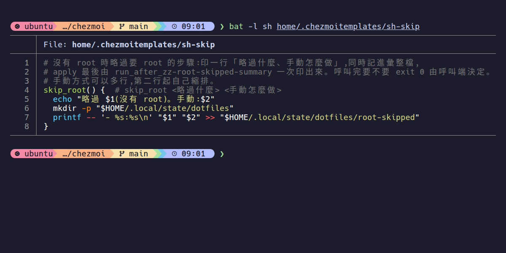
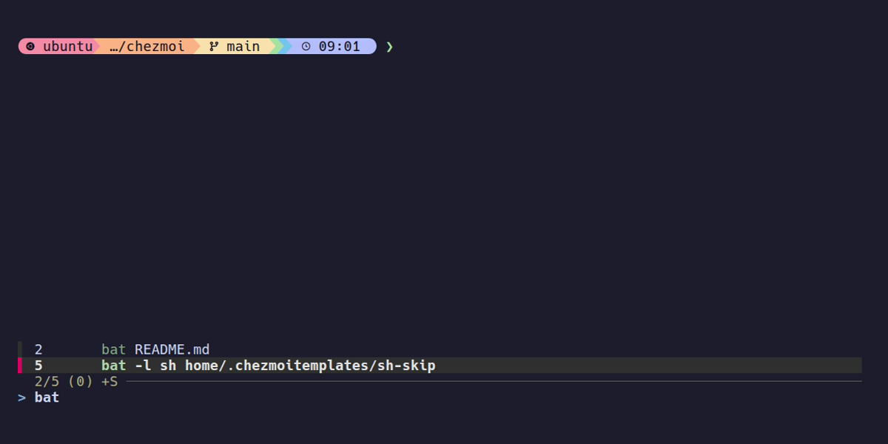

# 工具一覽

已配置主機上有哪些工具、各做什麼。這個 repo 有工具文件的連工具文件（`docs/tools/`），沒有的連官網。
怎麼連上已配置主機、怎麼開 agent，見[操作已配置主機](configured-host.md)。

哪些工具會裝，看那台的用途與勾選（[用途與憑證](how-to/machine-use.md)）；要加減用 `tools`。

```
shell 日常      zsh  starship  eza  fzf  bat  ripgrep  vim  fastfetch  btop  bottom  mise
入口與連線      tailscale  openssh-server  cloudflared  code-server  ttyd  gh
coding agent    herdr  claude  codex  opencode  agent-config
agent 輔助      codegraph  headless-chrome  playwright-cli  node  uv  windows-mcp
其他            ffmpeg  snapserver  snapclient  wakatime  earlyoom
自寫指令        tools  ai-profile  ttyd-serve  playwright-extension-attach  remote-access
                codegraph-setup-repo  voice-out  voice-out-speak
```

## shell 日常

| 工具 | 做什麼 | 連結 |
|---|---|---|
| zsh | 預設 shell；灰字建議（`→` 接受）、指令上色、`z <目錄名片段>` 跳常去的目錄 | [zsh](https://www.zsh.org/) |
| starship | 提示列：目錄、git 分支與狀態 | [starship](https://starship.rs/) |
| eza | 彩色、帶圖示的 ls（`ll`、`lt`） | [eza](https://eza.rocks/) |
| fzf | 模糊搜尋（`Ctrl-R` 打過的指令、`Ctrl-T` 檔案） | [fzf](https://github.com/junegunn/fzf) |
| bat | 有語法上色的 cat | [bat](https://github.com/sharkdp/bat) |
| ripgrep | 全文搜尋（`rg`） | [ripgrep](https://github.com/BurntSushi/ripgrep) |
| vim | terminal 裡的文字編輯器 | [vim](https://www.vim.org/) |
| fastfetch | 印出系統資訊 | [fastfetch](https://github.com/fastfetch-cli/fastfetch) |
| btop | 工作管理員：CPU、記憶體、行程 | [btop](https://github.com/aristocratos/btop) |
| bottom | 跟 btop 一樣（`btm`），Windows 也能裝 | [bottom](https://github.com/ClementTsang/bottom) |
| mise | Linux 上裝 eza、fzf、bat、ripgrep、starship、btop、bottom、fastfetch、cloudflared，也管它們的更新與移除 | [mise](tools/mise.md) |

`bat <檔案>`：語法上色、上面標檔名



`Ctrl-R` 開 fzf，打幾個字篩出打過的指令，Enter 帶回提示列



## 入口與連線

| 工具 | 做什麼 | 連結 |
|---|---|---|
| tailscale | 私人網路，連自己的機器 | [tailscale](https://tailscale.com/kb) |
| openssh-server | sshd：讓別台 ssh 進這台（WSL 聽 2222） | [OpenSSH](https://www.openssh.com/manual.html) |
| cloudflared | Cloudflare Tunnel：把服務開給 tailnet 外的人 | [cloudflared](https://developers.cloudflare.com/cloudflare-one/connections/connect-networks/) |
| code-server | 瀏覽器開的 VS Code | [code-server](https://coder.com/docs/code-server) |
| ttyd | 把 terminal 開成網頁，`ttyd-serve` 用它 | [ttyd](https://github.com/tsl0922/ttyd) |
| gh | GitHub CLI | [gh](https://cli.github.com/) |

## coding agent

| 工具 | 做什麼 | 連結 |
|---|---|---|
| herdr | terminal 多工，同時開多個 agent | [herdr](tools/herdr.md) |
| claude | Claude Code | [Claude Code](tools/claude.md) |
| codex | Codex CLI | [codex](tools/codex.md) |
| opencode | OpenCode | [opencode](tools/opencode.md) |
| agent-config | 用 skillshare 統一管理各 agent 的 skills、MCP、全域規則 | [skillshare](https://skillshare.runkids.cc/) |

## agent 輔助

多半是 agent 自己用，人很少直接打。

| 工具 | 做什麼 | 連結 |
|---|---|---|
| codegraph | 程式碼索引，給 agent 查 | [codegraph](tools/codegraph.md) |
| headless-chrome | 沒有畫面的 Chrome，給 agent 開網頁 | [Headless Chrome](https://developer.chrome.com/docs/chromium/headless) |
| playwright-cli | agent 點網頁、填表、截圖 | [playwright-cli](tools/playwright-cli.md) |
| node | Node LTS，給要 Node 的工具 | [mise 的 Node](https://mise.jdx.dev/lang/node.html) |
| uv | Python 套件與專案管理 | [uv](https://docs.astral.sh/uv/) |
| windows-mcp | 讓 agent 操作 Windows 桌面的 MCP server，只裝在 Windows 主機 | [Windows-MCP](https://github.com/CursorTouch/Windows-MCP) |

## 其他

| 工具 | 做什麼 | 連結 |
|---|---|---|
| ffmpeg | 影音轉檔、抽音軌與影格 | [FFmpeg](https://github.com/FFmpeg/FFmpeg) |
| snapserver | 朗讀串流服務：agent 的回覆唸到個人電腦 | [Snapcast](https://github.com/badaix/snapcast) |
| snapclient | 在個人電腦收聽朗讀串流 | [Snapcast](https://github.com/badaix/snapcast) |
| wakatime | 記錄寫程式的時間 | [WakaTime](tools/wakatime.md) |
| earlyoom | 記憶體快滿先砍最肥的程序，ssh 還連得上 | [earlyoom](tools/earlyoom.md) |

## 自寫指令

放在 `~/.local/bin`，這個 repo 自己寫的，沒有官網。

| 指令 | 做什麼 | 連結 |
|---|---|---|
| `tools` | 改用途、加減選裝工具 | [改設定與更新](after-install.md) |
| `codex-work`、`codex-personal`、`opencode-work`、`opencode-personal` | 用公司或個人帳號開 agent（都是 `ai-profile`） | [ai-profile](tools/ai-profile.md) |
| `ttyd-serve` | 把 terminal 開成網頁（綁 127.0.0.1、隨機密碼），Ctrl+C 就關；給 tailnet 外的人再接 `remote-access funnel` | [ttyd-serve](how-to/remote-access/ttyd-serve.md) |
| `playwright-extension-attach` | 讓 agent 經插件接你日常的 Chrome（勾了 `playwright-cli` 才有） | [瀏覽器](how-to/remote-access/browser.md#插件獨立-profile日常-profile-都能裝) |
| `remote-access` | 把一個 port 開成 tailnet 外的公開網址（Funnel、quick tunnel）：開、從公網驗證、收（勾了 `agent-config` 才有） | [開給別人連〈tailnet 外〉](how-to/remote-access/README.md#tailnet-外) |
| `voice-out` | 開關朗讀串流服務（勾了 `snapserver` 才有） | [voice-out](how-to/remote-access/voice-out.md) |
| `voice-out-speak` | 把 agent 最後一則回覆唸到朗讀串流服務，給 Stop hook 呼叫 | [voice-out](how-to/remote-access/voice-out.md#朗讀指令voice-out-speak) |
| `codegraph-setup-repo` | 幫一個 repo 建 codegraph 索引 | [codegraph](tools/codegraph.md) |
